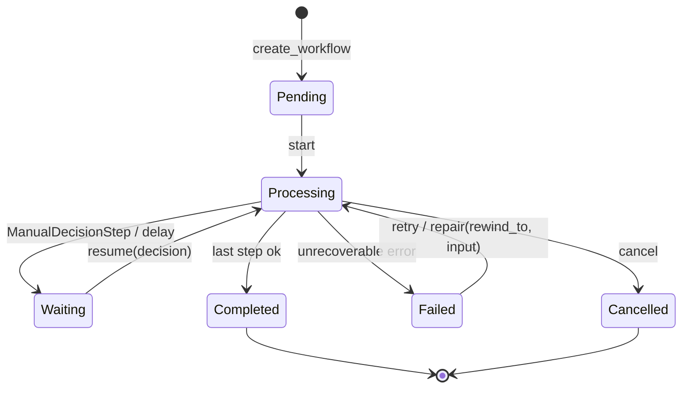

# Design Doc: Sentin8:Flow - Durable Workflow Engine

## 1. Summary

Sentin8:Flow is the platform's standalone workflow execution engine: a
durable state machine that runs versioned logic definitions step by
step. Domain steps proxy-back to the owning service's internal API;
built-in executors (HTTP call, manual decision, delay) execute
platform-side. Workflows pause on external decisions (`Waiting`), can
be retried, repaired (rewound), cancelled, and resumed with the
decision that unblocked them.

## 2. Motivation

- **Compensable multi-step work needs durability.** Provisioning,
  statement regeneration, and payment orchestration span minutes and
  cross services; an in-process state machine dies with the process.
  Flow persists every step result, so a crash resumes where it left.
- **One step engine, many domains.** Every service defines logic
  templates; Flow executes them uniformly (state machine, retries,
  audit) instead of each service embedding its own.
- **Human-in-the-loop is a first-class step.** Approvals park a
  workflow (`Waiting`) and `resume` injects the decision - approval
  applies the approver's authorization at execution time.
- **Event-triggered and API-triggered.** Workflows start from domain
  events (declarative `event_triggers` registration) or explicit API
  calls; both paths pin the same logic version.

## 3. Architecture & High-Level Design

- **Storage** - `flow.workflows` (RLS env-scoped): id, env, domain,
  logic id, state, input/output, current step, step results, callback
  config, timestamps.
- **Execution** - the engine advances one step at a time: a
  `BasicStep`/`HttpStep` executes built-in or proxies back to the
  owning service; a `ManualDecisionStep` parks in `Waiting`.
- **Proxy-back** - steps call the owning service's internal API with
  the DCR-issued cert-bound token (per-tenant M2M credentials instead
  of the static profile token where configured); the callback resolves
  tenant context from the workflow record before any domain write.
- **Host functions** - steps can delegate logic to Sentin8:Func WASM
  modules (import name → proxy-back path mapping).
- **Lifecycle verbs** - `retry` (from failure), `repair`
  (rewind to a step with replacement input), `cancel`, `resume` (with
  decision payload) - all audited.

## 4. Key Traits and Data Structures

- **`LogicVersion` / `StepDef`** - the template: named steps,
  `next_step` chaining, executor kind + config, `on_error` jump,
  versioned and pinned per instance.
- **`WorkflowRecord`** - the persisted state machine (mirrors the
  shared flow-contracts crate).
- **`CreateWorkflowRequest`** - domain, logic version, input, callback
  config, optional correlation id.
- **`StepOutcome`** - executor result: `Proceed` (continue) or
  `Waiting` (pause, optional deadline).
- **Step-handler profiles** - env-var-configured profiles mapping
  domain → internal path + auth material, loaded at boot.

## 5. Rationale, Trade-offs, and Alternatives

- **Six-state machine.** `Waiting` must be distinguishable from
  `Processing` (parked instances cost nothing); `Failed` vs
  `Cancelled` separates breakage from operator intent. Collapsing
  states would force operators to infer from step results.
- **Pinned logic version per instance.** Re-running a workflow months
  later must not pick up template changes; the instance carries its
  own copy (repair replays against a stable template). Trade-off:
  template duplication, accepted for determinism.
- **Proxy-back for domain steps.** Domain data stays in the owning
  service; Flow never accesses other services' tables. The callback
  re-derives tenant context from the record (never trusts the caller).
- **Repair as rewind-to-step.** Patch one step's input and re-run from
  there - full restart would repeat side effects. `rewind_to` +
  replacement input is the minimal repair primitive.
- **Resume carries the decision.** Waiting steps park on an external
  decision; injecting it as input re-enters the state machine
  deterministically. Polling-based waiting would waste cycles.
- **Idempotency keys end-to-end.** Event-triggered starts carry the
  envelope's idempotency key; step proxy-backs carry a step-level key
  so at-least-once delivery from retries is effectively-once.
- **Manual decision is its own executor.** Human approval is not
  "another HTTP call" - it has different semantics (no timeout by
  default, audit, approver's authorization). A generic pause mechanism
  would hide that.
- **Rejected: embedded workflow libraries.** Same durability and
  observability problems as embedded schedulers; the standalone
  engine centralizes state, audit, and operator verbs.
- **Rejected: saga-only (no steps).** Compensations need a step
  concept; Flow's steps ARE the saga's compensations, ordered and
  retryable.

## 6. Internal Implementation & Invariants (Private Design)

- **Invariants:**
  - Every state transition is persisted before the next step runs; a
    crash mid-step replays the step (idempotency key dedupes side
    effects).
  - Tenant context for proxy-back is derived from the workflow record
    (env_id) and set transaction-local on the callback connection -
    never inherited from the HTTP caller.
  - Cancelled/failed workflows keep their step results (audit).
  - `Waiting` without a deadline parks indefinitely (manual decision);
    a deadline expiry moves the instance to `Failed` with the timeout
    reason.
  - Lifecycle verbs are Shield-gated; the enforced scope-mirror set is
    the only gate.
  - Only one engine: shell boot loads the Shield engine and the shared
    admin state; the workflow engine is process-local (single-writer
    per instance via leader-aware advancement).
- **Boot (shell-owned).** The shell owns the listener stack; Flow
  loads step-handler profiles from env vars, registers the outbound
  M2M identity for proxy-backs (cert-bound, DCR-backed, with static
  fallback in dev), consumes the Shield engine, and mounts the API.
- **Store.** Workflows are updated via optimistic concurrency (state
  + updated_at guard); the engine re-reads before advancing to avoid
  clobbering concurrent lifecycle verbs.

## 7. Unresolved Questions / Future Designs

- Sub-workflows get `InitiateInstructionStep` spawn semantics (child from step
  config; result aggregation is the parent's completion step).
- A first-class `WaitStep` parks the workflow with `scheduled_at` = the target
  time; the deadline mechanism resumes it.
- Parallel steps model fan-out as N child workflows spawned from one step (the
  sub-workflow mechanism is the fan-out primitive).
- Workflow-level SLA tracking derives from the deadline mechanism (a stuck
  instance is one whose `waiting` deadline expired).

---

**Design attribution:** sentin8:flow and its underlying concepts were designed by Hamid Jahanzad <Hamid@Jahanzad.com>.
